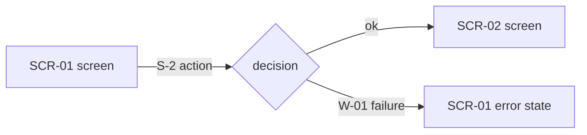

# UX flows — <feature>

> How the user moves through the feature, written by `/sdlc:ux-flows` and read by
> `prepare-design-spec` and `screens` (details every inventory row); name it in the prompt of
> `architecture-design` (target-surface evidence) and `plan-tests` (e2e-through-UI paths). **Always markdown + mermaid
> `flowchart`**, whatever the design tool. Provenance tokens: `AC-NN` (PRD), `BR-NN`
> (design-spec), `S-N` (story sentence), `W-NN` («what can go wrong», confirmed by the user),
> `N-NN` (an additional instruction from the command text next to a source), `D-NN` (derived:
> inferred, not confirmed — see Assumptions).

## Source

<!-- instruction: the input used and, in story mode, the story's sentences numbered S-1…S-n
     (quote them; the full story lives in story.md). Full mode: «PRD.md §4/§5». -->

- **Input:** <`docs/features/<slug>/PRD.md` | `story.md` | …>
- **Story sentences:** <S-1 «…» · S-2 «…» · … — story mode only>
- **From the command:** <N-01 «…» (narrowing / failure / screen / constraint) · … | none — text in the command next to the source above>
- **Contradictions with the source:** <N-NN vs AC-NN — decided: <source | command> — PRD gap for `/sdlc:clarify-prd` | none>

## Platform decisions

<!-- instruction: the posture these flows assume — default from docs/design/design-system.md; a
     deviation is named + justified. Plus flow-level decisions (navigation shape, dialog vs page).
     NO components, no layout — that is screens. -->

- **Posture:** <mobile-first | desktop-first | responsive-both> — <«per design-system» or the deviation + why>
- **On the canvas:** screens are static frames left to right in flow order; the clickable flow lives in code.

## Screen inventory

<!-- instruction: every distinct screen the flows visit. SCR-NN ids are the downstream contract
     (screens.md details each). «Branches landing here» lists the W/AC ids whose branch ends on this
     screen — screens turns them into states; N-NN items from the command count too. -->

| ID | Screen | Purpose | Entry | Exit | Branches landing here |
|---|---|---|---|---|---|
| SCR-01 | <name> | <one line> | <from where> | <to where> | <W-01, AC-03, …> |

## Flows

<!-- instruction: ONE flow per UI-touching §4 user story (full mode) or per user goal in the story
     (story mode), limited by an N-NN narrowing when the command gave one: happy path + one branch
     per W-NN / AC / N-NN failure. Nodes reference SCR ids. Edge labels
     carry the provenance token of the branch. Each flow is followed by its prose account. -->

### Flow: <US-n or goal — name>

<one-paragraph prose account: the happy path + every branch, in plain words>

## Coverage

<!-- instruction: one row per story sentence S-N and per W-NN (story mode) or per §5 AC (full
     mode), plus one row per N-NN item from the command in either mode, each pointing to the flow /
     branch / screen that shows it, or `N/A: <reason>`. -->

| Source | Item | Shown by | How | Note |
|---|---|---|---|---|
| S-1 | <sentence, short> | Flow <name> → <node> | flow / branch / N/A | <…> |
| W-01 | <failure> | Flow <name> → <branch> | branch | <…> |
| D-01 | <inferred failure — derived> | Flow <name> → <branch> | branch | see Assumptions |
| N-01 | <item from the command> | Flow <name> → <branch / screen> | branch / screen / narrowing | <from the command> |

Coverage: <n>/<n> story sentences (or user stories) · <m>/<m> failures (or ACs) · <j>/<j> items from the command — <k> N/A.

## Assumptions

<!-- instruction: every `D-NN` branch and every decision taken without asking (easy depth,
     headless run): «Assumed: <decision> — because <reason>. [veto?]». Otherwise «None.» -->

None.
